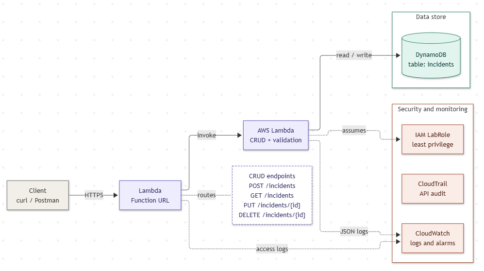

# Serverless Security Incident Ticketing System (Track C)

Sistem tiket insiden keamanan berbasis AWS Serverless (Lambda Function URL, AWS Lambda Python, DynamoDB) untuk proyek individu Komputasi Awan. Dirancang dengan mindset *blue team*: *least privilege*, log terstruktur, dan validasi input.

## Architecture


Alur data: `Client → Lambda Function URL → AWS Lambda (Python 3.12) → DynamoDB (tabel incidents)`

Garis putus-putus = relasi pendukung (routes, assume LabRole, logging); alarm CloudWatch dan audit CloudTrail diaktifkan pada tahap berikutnya. Kode diagram: [`docs/architecture.mmd`](docs/architecture.mmd) (Mermaid). Design brief: [`docs/Design_Brief_Incident_Ticketing.docx`](docs/Design_Brief_Incident_Ticketing.docx).

> **Catatan Learner Lab:** `dynamodb:CreateTable` ditolak untuk role `voclabs` (console, CLI, CloudFormation). Tabel dibuat lewat CLI memakai identitas IAM user `awsstudent`; Lambda tetap berjalan dengan `LabRole`. Endpoint memakai **Lambda Function URL** karena lebih sederhana daripada API Gateway untuk 4 operasi CRUD.

## Repository Structure
```text
.
├── docs/
│   ├── architecture.png / architecture.mmd
│   └── Design_Brief_Incident_Ticketing.docx
├── evidence/              # screenshot bukti AWS + TUTORIAL.md
├── scripts/               # seluruh perintah deployment (reproducible)
│   ├── config.sh
│   ├── 01_create_table.sh
│   ├── 02_deploy_lambda.sh
│   ├── 03_function_url.sh
│   ├── 04_test_crud.sh
│   ├── 05_monitoring.sh   # opsional / tahap lanjutan
│   └── 99_cleanup.sh
├── src/lambda_function.py # handler CRUD
├── tests/test_local.py    # tes lokal tanpa AWS
└── README.md
```

## API Endpoints
| Method | Endpoint | Fungsi | Sukses | Error |
| :--- | :--- | :--- | :--- | :--- |
| `POST` | `/incidents` | Membuat tiket | `201` | `400` |
| `GET` | `/incidents` | Melihat semua tiket | `200` | |
| `GET` | `/incidents/{id}` | Detail satu tiket | `200` | `400`, `404` |
| `PUT` | `/incidents/{id}` | Ubah `title`/`description`/`severity`/`status` | `200` | `400`, `404` |
| `DELETE` | `/incidents/{id}` | Hapus tiket | `200` | `404` |

Validasi: `severity` ∈ {low, medium, high, critical}; `status` ∈ {open, investigating, resolved}; `title` wajib (maks. 100); `description` maks. 1000; field tidak dikenal ditolak.

## Deployment Plan
Jalankan dari **AWS CloudShell** (region `us-east-1`), setelah `git clone` repo ini. Sandbox menghapus resource saat sesi habis, jadi urutan ini bisa diulang dari nol.

1. `./scripts/01_create_table.sh`: buat tabel DynamoDB `incidents` (PAY_PER_REQUEST). Jika `AccessDenied`, jalankan dengan kredensial `awsstudent` (jangan di-commit).
2. `./scripts/02_deploy_lambda.sh`: package `src/lambda_function.py`, buat fungsi `incident-api` dengan `LabRole`, env `TABLE_NAME=incidents`.
3. `./scripts/03_function_url.sh`: buat Lambda Function URL.
4. `./scripts/04_test_crud.sh`: uji seluruh endpoint CRUD.
5. (Lanjutan) `./scripts/05_monitoring.sh email@kamu.com`: metric filter, alarm, SNS.
6. `./scripts/99_cleanup.sh secure` setelah pengujian (Function URL → `AWS_IAM`), atau `all` untuk hapus semuanya.

Tes lokal tanpa AWS: `python3 tests/test_local.py`

## Security Notes
- Tanpa kredensial di kode dan repo; akses memakai execution role.
- Function URL dengan `Auth type: NONE` bersifat publik, hanya untuk pengujian, lalu diubah ke `AWS_IAM`. Mitigasi lain: validasi input, batas ukuran field, reserved concurrency.
- Rencana produksi: role khusus dengan izin `PutItem/GetItem/UpdateItem/DeleteItem/Scan` hanya pada tabel `incidents`.
- Lambda menulis log JSON (`request`, `validation_failed`, `not_found`, `incident_*`) ke CloudWatch sebagai bahan alarm.
